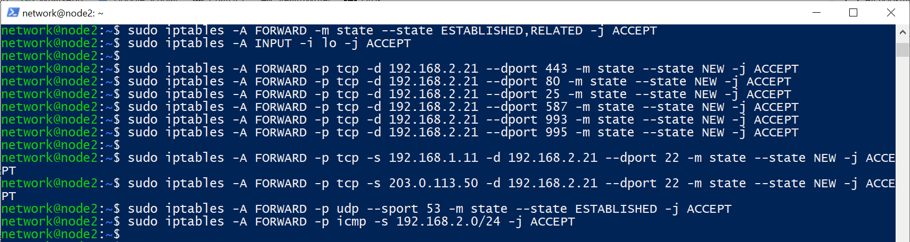
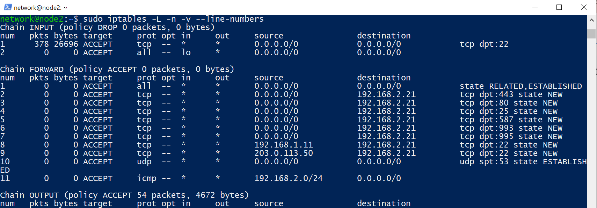
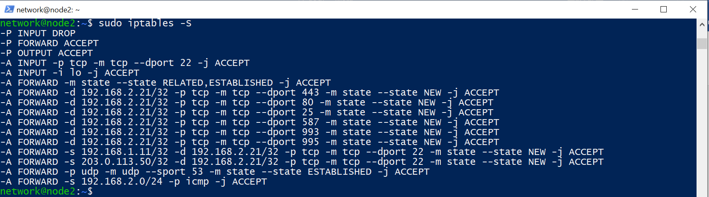
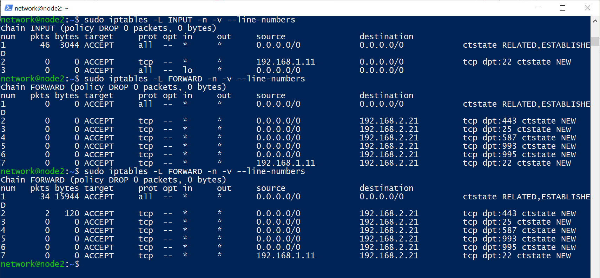

# Week 6 – Firewalls and iptables

## Aim and network context

The aim of the firewall practical was to configure packet-filtering and stateful rules on **node2** in virtnet topology 5. The external client is **node1** (`192.168.1.11`); the internal server is **node3** (`192.168.2.21`). The relevant distinction is between traffic addressed **to node2** (`INPUT`) and traffic **passing through node2** toward node3 (`FORWARD`).

## 1. Initial firewall rules: configuration evidence

The supplied command-history screenshot shows iptables rules being appended to the `FORWARD` chain, including established/related connections, HTTPS, HTTP, selected mail ports, and SSH from named source addresses. The screenshots are evidence of an **earlier configuration**, not the final restrictive policy.



The earlier listing showed `FORWARD (policy ACCEPT)`, an HTTP/80 rule, and unrestricted access to node2's SSH service through an `INPUT` rule. These were identified as security weaknesses because an unmatched forwarded connection would still be accepted.





## 2. Revised firewall policy: final evidence

The later node2 screenshot demonstrates the revised policy:

- `INPUT` **policy DROP**; established/related traffic is permitted.
- SSH **to node2** is permitted only from `192.168.1.11`; loopback remains permitted.
- `FORWARD` **policy DROP**, with explicit stateful exceptions.
- External TCP requests to node3 `192.168.2.21` may reach HTTPS `443` and the example mail-service ports `25`, `587`, `993`, `995`.
- SSH `22` **to node3** is accepted only from `192.168.1.11`.
- TCP `80` is absent from the final allow list; under the shown `FORWARD DROP` policy unmatched HTTP traffic is dropped.



The final screenshot shows a nonzero counter on the `FORWARD` HTTPS rule (2 packets/120 bytes in the later listing), consistent with traffic matching TCP 443. A rule counter alone does **not** prove every requested end-to-end test succeeded; the application/SSH tests must be documented separately.

### Examples of the stateful filtering syntax evidenced in the work

The original commands included `-m state --state ...`; the revised policy has the same logic using `conntrack` syntax. A representative record of the final configuration logic is:

```bash
# Representative policy and rules; do not blindly append duplicates to a live firewall.
sudo iptables -P FORWARD DROP
sudo iptables -A FORWARD -m conntrack --ctstate ESTABLISHED,RELATED -j ACCEPT
sudo iptables -A FORWARD -p tcp -d 192.168.2.21 --dport 443 -m conntrack --ctstate NEW -j ACCEPT
sudo iptables -A FORWARD -p tcp -s 192.168.1.11 -d 192.168.2.21 --dport 22 -m conntrack --ctstate NEW -j ACCEPT
```

## 3. Interpretation and rationale

A default DROP policy reduces the set of reachable internal services. The `ESTABLISHED,RELATED` rule allows return packets for already permitted sessions without creating overly broad inbound allowances. Limiting SSH by source address helps constrain administrative access. This is *source-IP restriction*, not a substitute for SSH authentication or additional access controls.

The final change also resolves the earlier inconsistency between the report caption's default-deny claim and the old `FORWARD ACCEPT` listing.

