# Week 8 – Linux file permissions and access control

## Aim and access-control policy

The organisation has three departments (HR, Finance and IT). Its access-control objective is to prevent department users from reading or modifying files in another department's directories. Linux owner/group/other permissions and departmental supplementary groups were used to implement this separation on **node1**.

## 1. Create department groups

The group-creation screenshot shows these commands and verification with `getent`:

```bash
sudo groupadd hr_group
sudo groupadd fin_group
sudo groupadd it_group
getent group hr_group fin_group it_group
```

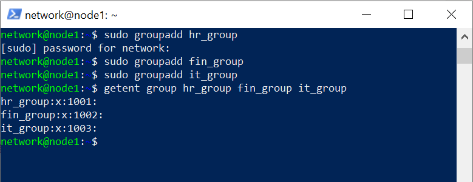

Six accounts and their departmental memberships are shown in the Week 7 evidence screenshots:

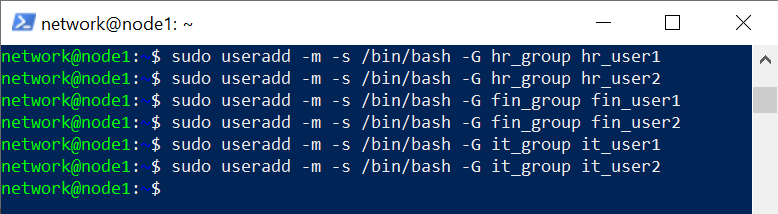

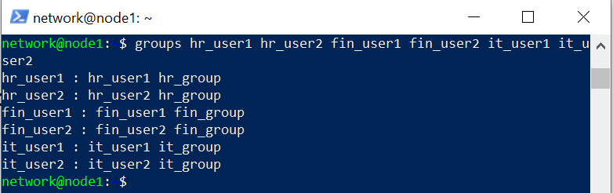

## 2. Create protected directories and configure ownership

The terminal screenshot records creation of `/home/dept`, its three departmental directories, assignment of group ownership (`chgrp`) and setting the protection mode to `770` and SGID inheritance on the department folders.

```bash
sudo mkdir -p /home/dept
sudo mkdir /home/dept/hr
sudo mkdir /home/dept/fin
sudo mkdir /home/dept/it
sudo chgrp hr_group /home/dept/hr
sudo chgrp fin_group /home/dept/fin
sudo chgrp it_group /home/dept/it
sudo chmod 770 /home/dept/hr /home/dept/fin /home/dept/it
sudo chmod g+s /home/dept/hr /home/dept/fin /home/dept/it
```

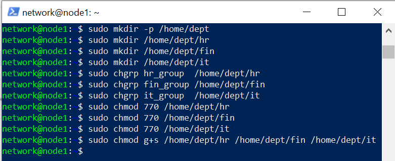

The verification screen displays permissions `drwxrws---`, meaning directory owner and group have read/write/execute access, others have no access, and the setgid bit is active so new files/directories inherit the departmental group.

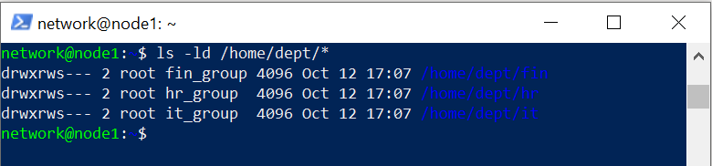

**Why directory execute matters:** For a directory, `x` controls traversal/searching. Users outside the corresponding group cannot traverse another department's protected directory even if they know a filename.

## 3. Create test files while logged in as department users

The user-switching screenshot shows successful `su - <user>` authentication prompts and `echo` commands producing each user's text file within their department. The recursive listing confirms all three department folders contain two departmental files.

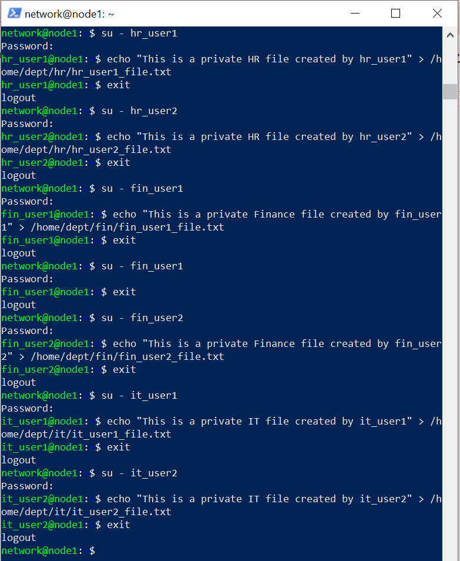

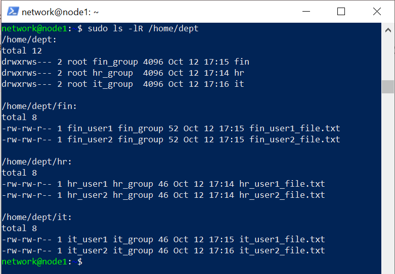

## 4. Verify that cross-department access is denied

The evidence shows three different cross-department attempts:

| Logged-in user | Target | Read test | Write test |
|---|---|---|---|
| `fin_user1` | `/home/dept/hr/hr_user1_file.txt` | Permission denied | Permission denied |
| `it_user1` | `/home/dept/fin/fin_user1_file.txt` | Permission denied | Permission denied |
| `hr_user1` | `/home/dept/it/it_user1_file.txt` | Permission denied | Permission denied |

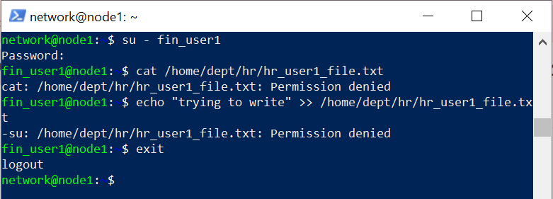

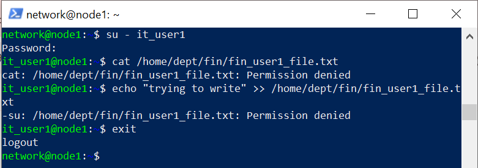

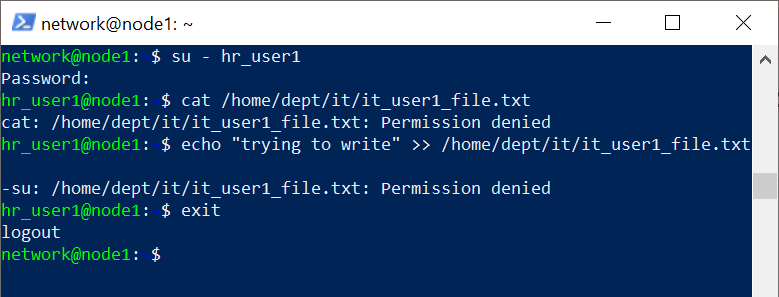

An authorised same-department check is also present: `hr_user1` can read their own HR text file and list `/home/dept/hr/`.

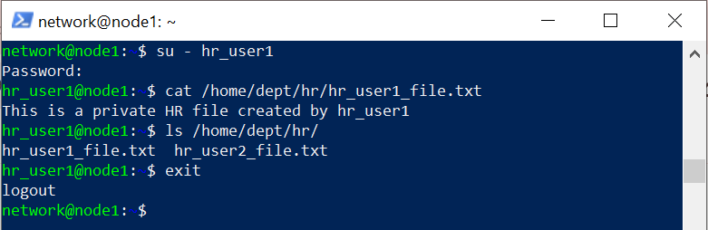

## 5. Analysis

The results demonstrate *least privilege between groups*: HR users cannot access Finance and IT directories, and equivalent boundaries protect Finance and IT. The screenshots support read/write denials under the tested conditions. The model depends on correct user-to-group membership, appropriate directory permissions and ordinary nonprivileged users; administrators with root access are not restricted in the same way.

For future hardening, consider default ACLs if group write permissions are needed consistently on newly created files. SGID inherits the **group ownership**, but does not by itself force every new file to be group-writable because the user's `umask` also affects file modes.

## Evidence summary

**Documented:** Groups, six user accounts, directory ownership and mode, file creation, recursive listings, three cross-department read/write denials, and a permitted same-group test. These directly support Q1 Phases 3–5.
