# Week 9 – HTTPS, digital certificates and TLS

## Aim and network environment

The work configures an Apache HTTPS server on **node3** (`192.168.2.21`) and accesses it from **node1** (`192.168.1.11`) through node2. The virtual host uses **`www.12317674.edu`**. A demonstration certificate authority (CA) signs the server's certificate, which the client explicitly trusts.

## 1. Create the certificate signing request (CSR)

The command recorded on node3 is:

```bash
openssl req -new -key 12317674-keypair.pem -out 12317674-csr.pem
```

The screenshot shows a CSR for `www.12317674.edu` with organisation and contact fields. **Review required:** the input has **State/Province = Melbourne** and **Locality/City = Victoria**; the assignment states these should reflect the campus state and city, so the intended values are *Victoria* for state and *Melbourne* for locality. Preserve the screenshot as evidence of the actual command but do not represent the fields as corrected unless the CSR and certificate are regenerated and retested.

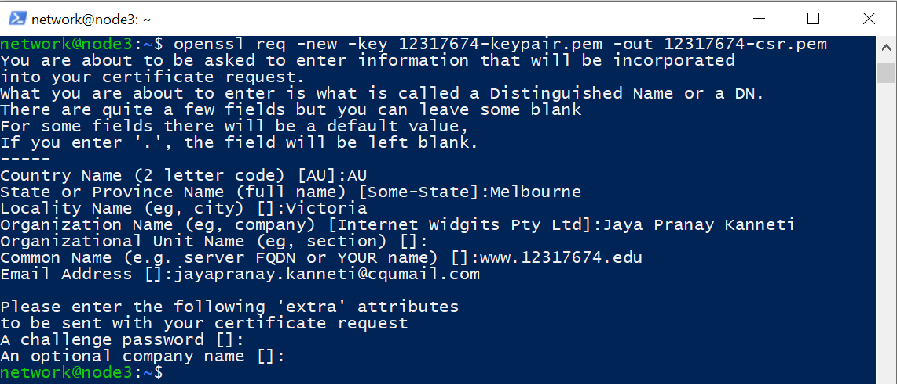

## 2. Prepare the demonstration CA

The recorded work generates a separate CA RSA private key and issues a self-signed CA certificate:

```bash
openssl genrsa -out 12317674-ca-keypair.pem 2048
openssl req -x509 -new -nodes -key 12317674-ca-keypair.pem -sha256 -days 3650 -out 12317674-ca-cert.pem
```

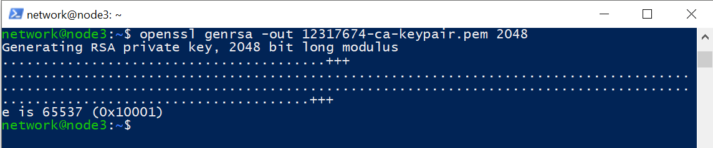

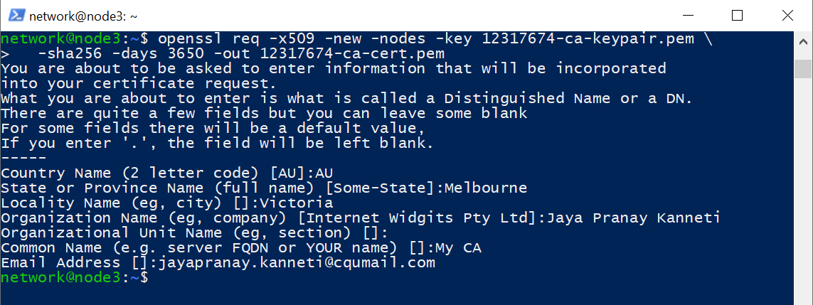

The screenshots next show OpenSSL's `ca` command signing the CSR and the verification command reporting `12317674-cert.pem: OK`:

```bash
openssl ca -in 12317674-csr.pem -out 12317674-cert.pem \
  -keyfile 12317674-ca-keypair.pem -cert 12317674-ca-cert.pem \
  -outdir demoCA/newcerts -config /etc/ssl/openssl.cnf
openssl verify -CAfile 12317674-ca-cert.pem 12317674-cert.pem
```

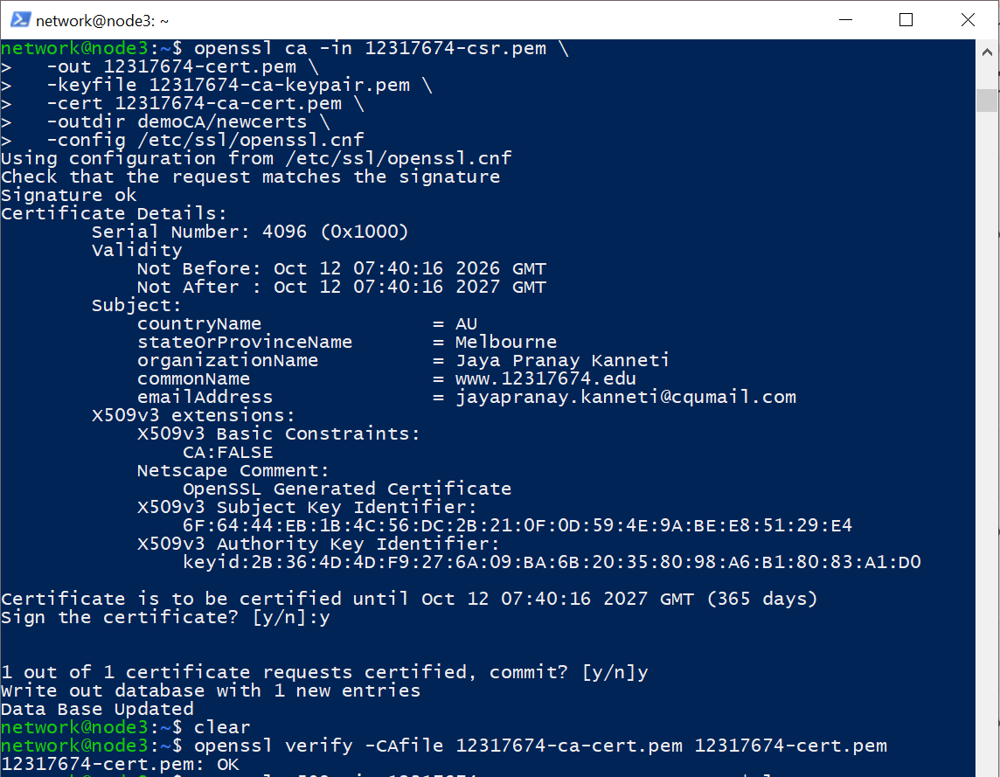

**Interpretation:** `openssl verify ... OK` confirms that the certificate chains to the specified local CA under the verifier's applicable checks; it is not proof that a public browser or arbitrary external computer trusts that demo CA.

## 3. Install HTTPS certificates and configure Apache

The certificate and private-key paths are shown being installed on node3. The Apache `default-ssl.conf` screenshot contains:

```apache
ServerName www.12317674.edu
SSLEngine on
SSLCertificateFile /etc/ssl/certs/12317674-cert.pem
SSLCertificateKeyFile /etc/ssl/private/12317674-keypair.pem
SSLCertificateChainFile /etc/ssl/certs/12317674-ca-cert.pem
```

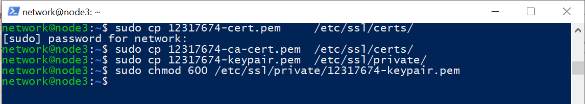

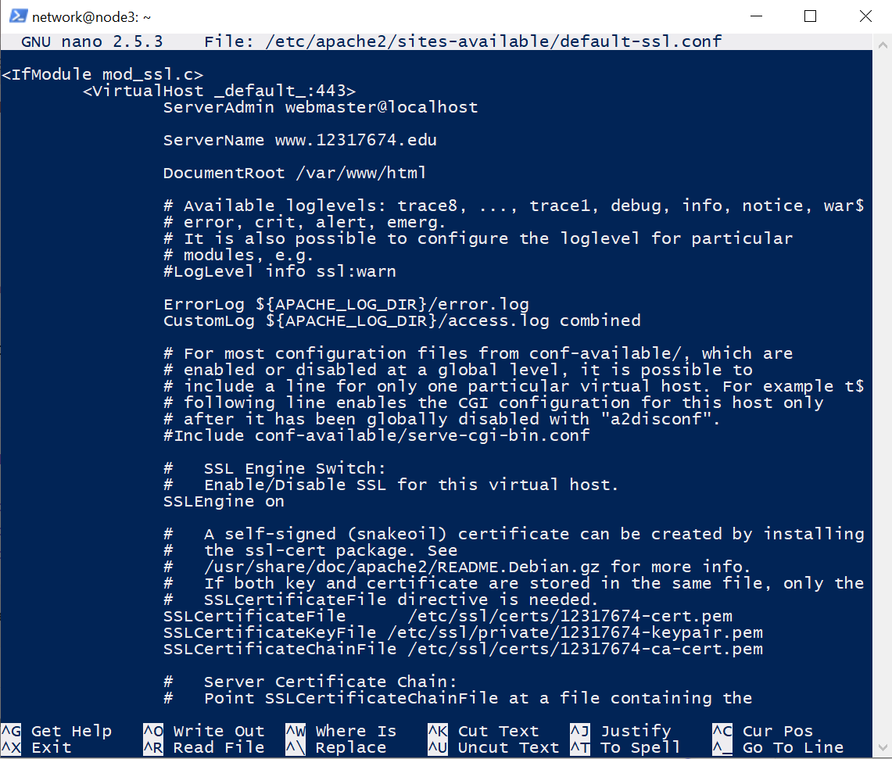

The next screenshot confirms the SSL module and `default-ssl` site were enabled. `apache2ctl configtest` returned `Syntax OK`, followed by an Apache restart and **`Active: active (running)`**.

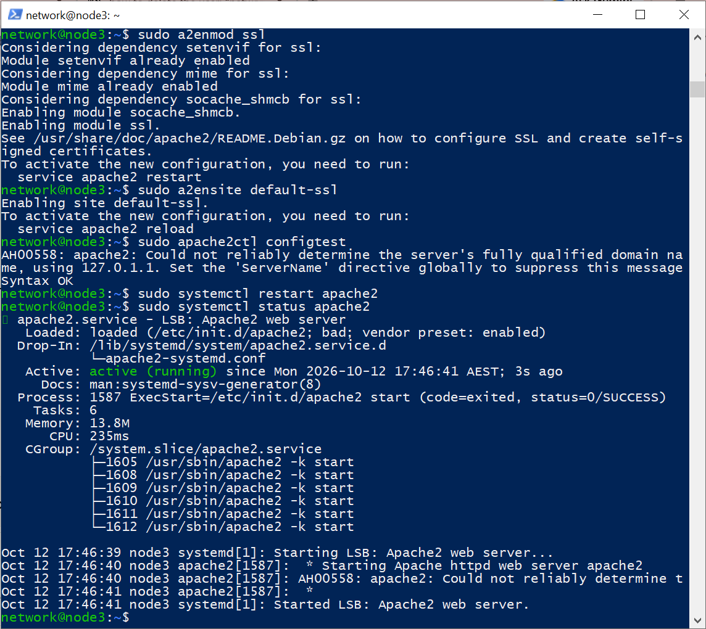

## 4. Trust the demonstration CA on the client

On node1, the terminal screenshot records copying the CA certificate from node3 using `scp`, placing it in the local CA directory and running `update-ca-certificates`. Output reports **`1 added, 0 removed`**.

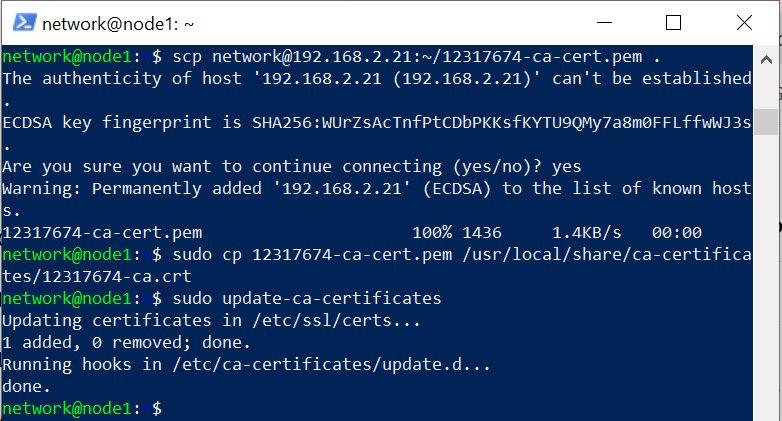

**Security note:** This is appropriate for a controlled teaching lab, but a private/demo CA should not be distributed or trusted indiscriminately on production clients. Do not share or upload the CA **private key**; only its public certificate is intended for client trust.

## 5. HTTPS page verification and traffic capture

The client-side Lynx screenshots display the MyUni welcome page and grades page following the server setup. The screenshots show rendered site content; the page UI itself does not display an explicit URL, so use the accompanying HTTPS capture/TLS evidence when demonstrating transport security.

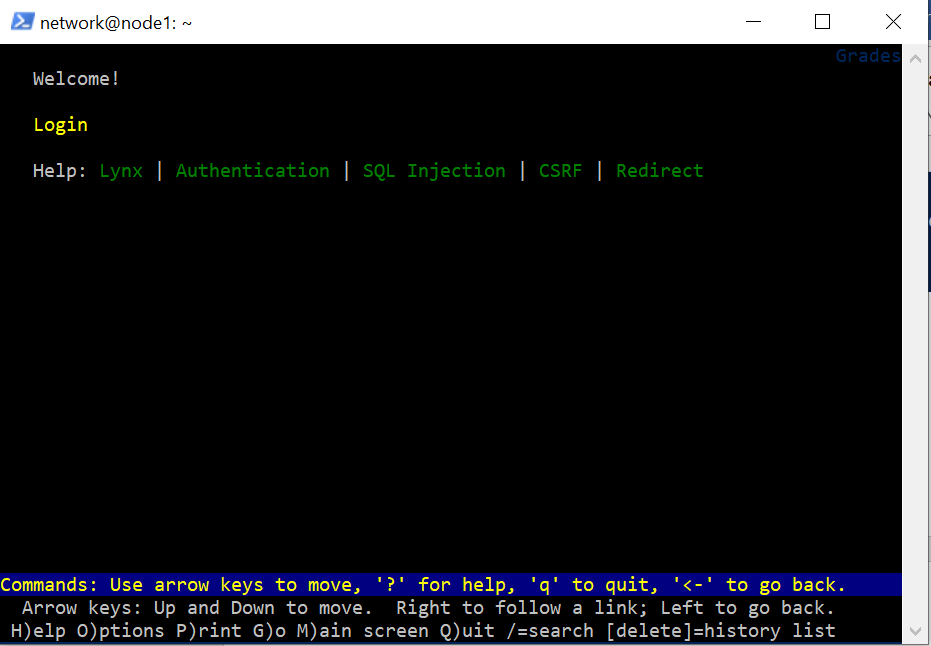

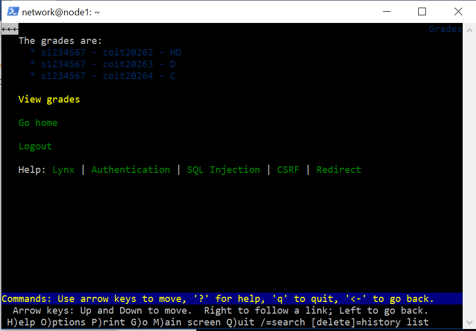

The node2 packet-capture terminal shows:

```bash
sudo tcpdump -i any -w 12317674-https.pcap port 443
```

It reports a shorter capture (16 packet records) and a file named `12317674-https.pcap`, and the journal should not imply those packet counts are identical without confirming the export/process used.

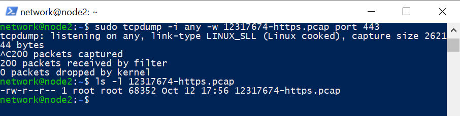

## 6. TLS message-sequence analysis

The updated report figure shows the first observed HTTPS handshake between node1 and node3, with TLS messages labelled by packet number. The diagram excludes TCP SYN/ACK and TCP teardown frames as the assignment requires.

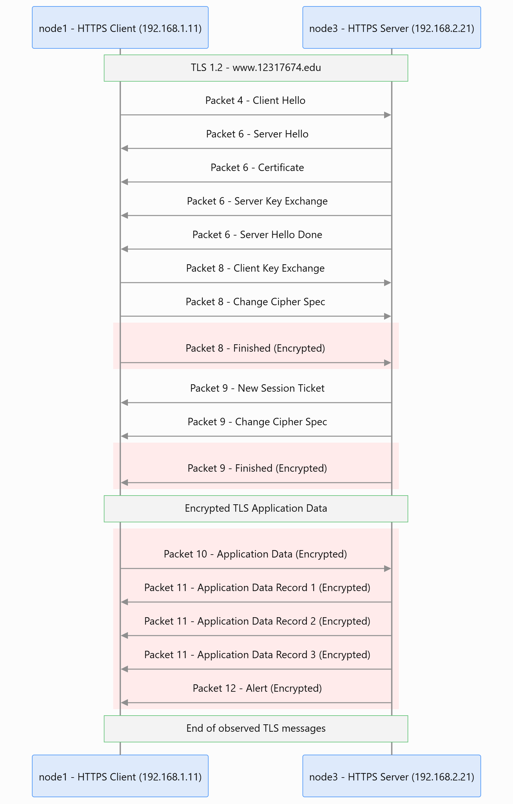

| Packet | Observed TLS messages in the diagram | Visibility |
|---|---|---|
| 4 | Client Hello | Unencrypted handshake |
| 6 | Server Hello, Certificate, Server Key Exchange, Server Hello Done | Unencrypted handshake |
| 8 | Client Key Exchange, Change Cipher Spec, Finished | Finished encrypted after cipher activation |
| 9 | New Session Ticket, Change Cipher Spec, Finished | Finished encrypted after cipher activation |
| 10 | Client Application Data | Encrypted |
| 11 | Server Application Data (three records) | Encrypted |
| 12 | Alert | Encrypted |

The `Change Cipher Spec` message signals the transition to the negotiated cipher state in this TLS 1.2 flow. After that, application data and the Finished messages identified in the figure are encrypted on the wire. TLS encryption protects data between the communicating endpoints; it does not automatically ensure that an improperly trusted CA cannot issue an impersonating certificate.

## 7. Security reflection and follow-up

Compromise of a CA's signing private key allows forged certificates accepted by clients that trust that CA. An attacker who can intercept or redirect traffic can impersonate the HTTPS server, including conducting a man-in-the-middle attack. CA key material therefore needs strong protection, and client trust in a compromised CA must be revoked or removed.

