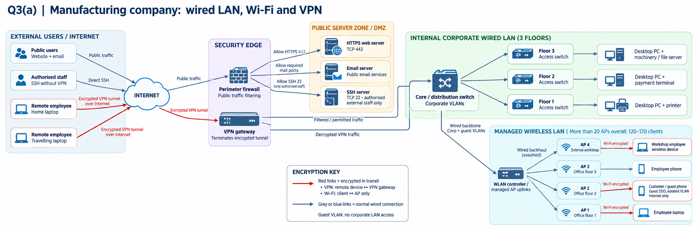

# Week 10 – Wireless LAN security

## Aim

The tutorial covers WPA2-PSK protection, analysing IEEE 802.11 Wi-Fi frames in Wireshark, and understanding which information remains visible even when a wireless link is encrypted. The assignment also applies wireless security in a proposed network upgrade for a manufacturing organisation.

## 1. Wireless network design evidence (assignment Q3a)

The latest supplied report includes a proposed network architecture for approximately **120–170 wireless clients** and **more than 20 access points**. It shows managed access points across three office floors and an external workshop, with separate employee and guest access. The sample devices stand in for the larger deployment.

### Architecture and controls illustrated

- A core/distribution switch connects office-floor access switches and wired devices.
- The managed wireless network uses a wireless controller or managed AP uplinks.
- Employee devices associate to office/workshop access points using protected Wi-Fi links.
- Guest wireless devices use a separate SSID and VLAN with Internet-only access, not internal corporate LAN access.
- External home/travelling staff use VPN tunnels; this is a **different encrypted path** from Wi-Fi's client-to-AP protection.
- A perimeter firewall and public-facing DMZ separate exposed services from private systems.

**Scope of evidence:** The figure is a **network design**, not proof that a real AP, WPA session, or guest VLAN was configured and tested. The figure was embedded in the provided report and does not replace your own practical Wireshark analysis. Also confirm that the final diagram accurately highlights **every** Wi-Fi encrypted client-to-AP link (some sample wireless links may not be red in the image).

## 3. Why some traffic is still unreadable

WPA2 encrypts the wireless hop between an associated client and its access point. If the WLAN key is known and the relevant handshake is available, Wireshark can sometimes decrypt those Wi-Fi frames. However, traffic protected by HTTPS/TLS is encrypted **again at the application/transport security layer**; knowing a WLAN key does not reveal protected HTTPS page content. Management/beacon metadata may remain visible even when payload data is protected.

## Evidence summary

**Documented:** Wireless/VPN security architecture proposal in the submitted report.  